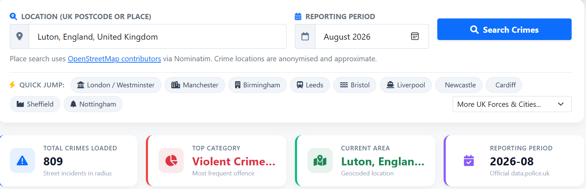
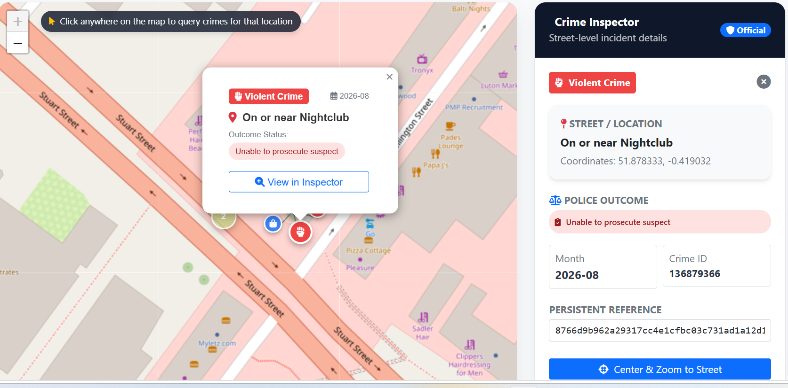

# PoliceDataApp

A Flask web interface for the [UK Police Data API](https://data.police.uk/docs/), with an interactive crime map, police force directory, neighbourhood profiles, stop-and-search records, and crime analytics.

## In-app experience

[Explore the live app](https://lionfish-app-dslpv.ondigitalocean.app/).

### Find crimes by location

Search by UK postcode or place, choose a reporting month, or jump to a city. Summary cards show the number of incidents, leading crime category, selected area, and reporting period.



### Inspect individual incidents

Select a crime marker to view its street location and recorded outcome in the map popup and Crime Inspector.



## Run locally

```bash
python3 -m venv .venv
source .venv/bin/activate
pip install -r requirements.txt
python app.py
```

Open http://localhost:5000. Python 3.10 or newer is supported. The web pages load Bootstrap, Leaflet, MarkerCluster and Chart.js from public CDNs, so an internet connection is required. `setup.py` is the original project generator and rewrites application files; use the commands above to run this version.

The map uses standard OpenStreetMap tiles, with visible attribution and no API key. Normal browser caching is preserved; see the [tile usage policy](https://operations.osmfoundation.org/policies/tiles/).

## Deploy on DigitalOcean App Platform

Deploy the repository as a Python web service, with these component settings:

- **Run Command:** `gunicorn --bind 0.0.0.0:$PORT --workers 1 --threads 4 --timeout 120 --worker-tmp-dir /dev/shm --access-logfile - --error-logfile - app:app`
- **HTTP Port:** `8080`
- **HTTP health-check path:** `/health`

The checked-in `Procfile` supplies the same startup configuration for buildpacks. An example App Platform spec is in [.do/app.yaml](.do/app.yaml); when updating an existing app, retain its existing resource settings. Saving this file in GitHub does not change an existing app's component settings automatically. Set the Run Command, HTTP Port, and health check in DigitalOcean, then rebuild and deploy the latest commit. Do not use `python setup.py` as the build or run command; it generates and overwrites application files.

Gunicorn is installed by `requirements.txt`, listens on all interfaces using DigitalOcean's `PORT`, and uses `/dev/shm` for worker temporary files as recommended by the [Python buildpack documentation](https://docs.digitalocean.com/products/app-platform/reference/buildpacks/python/). A single worker keeps the in-memory cache and place-search rate limiter shared between request threads. The server timeout allows upstream requests to finish.

`GET /health` returns `200` with `{"status":"ok"}` and never contacts the police or geocoding APIs. Use it for platform probes so an upstream outage cannot make a running app appear unhealthy. `python app.py` also respects `PORT` when set and defaults to port 5000 for local development, with debugging disabled.

To reproduce the platform startup locally:

```bash
PORT=8080 sh -c "$(sed 's/^web: //' Procfile)"
# In another terminal:
curl --fail http://localhost:8080/health
```

## Browser views

- **Dashboard:** search UK postcodes or place names, jump to a city, use your location, or select coordinates on the map. Incidents cluster as you zoom; category filters and the inspector show street names and recorded outcomes.
- **Crimes:** use the same postcode/place lookup and location-selection form as Analytics and Stop & Search, then search a reporting month and read street names and outcomes. Coordinates can also be entered directly.
- **Forces:** search the directory, open a force's contact details in a modal, then follow its neighbourhood link.
- **Neighbourhoods:** browse and filter local areas, then inspect the overview, policing team, priorities, and events. Partial upstream failures appear as warnings.
- **Stop & Search:** choose a location or police force and reporting month. View summaries, filter by search object, and page through records, including records without published coordinates.
- **Analytics:** choose a location and reporting month to view category/outcome charts and the corresponding tables.
- **Goodies:** preview the Nosey Neighbours sheet of six different 70 mm avatar QR-code stickers and support the app when ordering opens.

Month selectors use the latest published crime month. A blank month lets the upstream API choose its latest data. Coverage and publication dates vary by force and dataset; an empty response means no published records for that query. Crime coordinates are anonymised and approximate.

## Goodies and sticker purchases

`/goodies` shows the six-design sticker sheet and is linked from the main navigation
and footer. The artwork comes from the B&S Labels mixed-sheet proof dated
28 October 2026. It is a design preview, not a guarantee of the final print.

The page defaults to **Coming soon**, with pricing to be confirmed and ordering
disabled while the first batch is being arranged. To open sales once stock and
fulfilment are ready, set both runtime environment variables:

- `GOODIES_PRICE`: the displayed price per sheet, including currency (for example,
  `£5.00`; this is an illustration, not the agreed selling price).
- `GOODIES_CHECKOUT_URL`: the full HTTPS URL of your hosted product checkout.

Configure the actual price, sheet quantity, shipping charges, delivery information,
and shipping-address collection in the payment provider's checkout. The app links
to that checkout; it does not collect payments or store orders. The displayed price
must match the checkout price. Remove `GOODIES_CHECKOUT_URL` to pause sales.

## Application API

All endpoints use GET. Successful list endpoints return arrays; details and summary endpoints return objects.

| Endpoint | Description |
| --- | --- |
| `/api/forces` | List police forces |
| `/api/force/<force_id>` | Force details |
| `/api/force/<force_id>/people` | Force personnel |
| `/api/crime-categories` | Published crime categories |
| `/api/crimes/last-updated` | Latest crime publication date, `{ "date": "YYYY-MM-DD" }` |
| `/api/crimes/street?lat=&lng=&date=YYYY-MM` | Street crimes near coordinates |
| `/api/geocode/postcode?q=SW1A%201AA` | Postcode lookup, `{ "success": true, "result": { "lat": ..., "lng": ... } }` |
| `/api/geocode/search?q=Leicester` | UK place matches with `display_name`, `lat`, and `lng` |
| `/api/neighbourhoods/<force_id>` | Force neighbourhood list |
| `/api/neighbourhood/<force_id>/<id>` | Composite `details`, `team`, `priorities`, `events`, and `warnings` |
| `/api/stop-search/street?lat=&lng=&date=YYYY-MM` | Stop-and-search records near coordinates |
| `/api/stop-search/street?force=leicestershire&date=YYYY-MM` | Force stop-and-search records, including those without locations |
| `/api/analytics/summary?lat=&lng=&date=YYYY-MM` | Total, category and outcome counts/percentages |

`date` is optional. Crime and analytics queries default to central London when no scope is supplied. Stop-and-search requires either both coordinates or a force; combining a force and coordinates returns 400. Invalid arguments return 400, an unknown postcode returns 404, and upstream failures return 502 with `{ "success": false, "error": "..." }`.

For API consumers, the analytics endpoint also accepts `force`, but this uses the upstream [crimes without a location](https://data.police.uk/docs/method/crimes-no-location/) dataset. Its `scope: "unmapped-crimes-only"` identifies that subset; it is not the total crime count for a force. The dashboard uses local street-level summaries.

## Caching and geocoding

Successful upstream responses, including empty lists, are cached in memory for 600 seconds by default, with at most 1,024 entries. Concurrent police-data queries share cached results. A 429 response receives one bounded retry; failed requests are not cached. Caching reduces repeated requests but cannot guarantee that upstream services will never rate-limit the app.

Postcodes use [Postcodes.io](https://postcodes.io/); place searches use [Nominatim](https://nominatim.org/) and are submitted explicitly, with OpenStreetMap attribution. Nominatim requests are cached and limited to one per second within the application process. For a deployment with multiple workers, coordinate rate limiting across processes or use a suitable geocoding provider. Set `NOMINATIM_SEARCH_URL` to switch to a compatible search service. Follow the provider's [usage policy](https://operations.osmfoundation.org/policies/nominatim/).

## Optional application telemetry

The production collector is disabled until `TELEMETRY_DATABASE_URL` is set. It
does not add an admin route. The collector records request counts, server-handler
timings, status codes, route patterns, and coarse browser/device categories.
Presence uses a random identifier in the tab's session storage; no tracking cookies,
fingerprinting, IP addresses, query strings, search terms or precise locations are
stored. Do Not Track and Global Privacy Control disable session presence. Anonymous
request counts still contribute to performance metrics.

To enable it, initialize a PostgreSQL database with
`TELEMETRY_DATABASE_URL=... python -m utils.telemetry_store` using a setup account,
then give the runtime account `SELECT, INSERT, UPDATE, DELETE` on the three
`telemetry_*` tables and `USAGE` on their schema. Configure its connection string
as the encrypted **runtime** variable `TELEMETRY_DATABASE_URL` in DigitalOcean's
web-service settings. Keep credentials out of repository files. Remote database
connections require TLS; connection strings can specify `sslmode=verify-full` and
`sslrootcert` for certificate verification. No database connection is made during
build, import, app startup, health checks, or normal request handling.

When enabled, a small deferred first-party script sends at most one presence
request per minute from a visible, online tab after page load. Storage-disabled
browsers skip presence. The script never displays UI, changes the map, or blocks
application requests. The server uses one daemon writer per worker, a queue of
at most 2,048 events, batches of at most 128, and at most 100 accepted events per
second per worker. The writer flushes every two seconds and backs off for 5–60
seconds on database failures. Full queues, overload, outages and process exits
can drop metrics; telemetry is best-effort, not an audit log. Failure logs omit
connection details. `TELEMETRY_ENABLED=0` disables collection completely.

Request history is aggregated by route, method, status and minute. Response
percentiles are estimates from fixed latency buckets. Recent errors are route/minute
groups, without error bodies. Sessions and minute aggregates have seven-day
retention, with bounded background cleanup. A PostgreSQL database preserves data
across App Platform container replacements; local SQLite files cannot provide
that persistence. See [DigitalOcean storage limits](https://docs.digitalocean.com/products/app-platform/details/limits/).

This repository's `.do/app.yaml` currently defines a web service only. It does not
provision a database or supply telemetry credentials. Attaching a database and
configuring runtime variables are separate DigitalOcean account operations; pushing
code does not create them. The application works normally before they are set.

## Verification

Backend and JavaScript regression checks run without upstream network access:

```bash
python -m unittest discover -s tests -p 'test_*.py' -v
python tests/deployment_smoke.py
node --test tests/test_home_map.js tests/test_subpages.js tests/test_telemetry.js
```

The PostgreSQL integration tests run against the isolated `police_telemetry_test`
database when `TELEMETRY_TEST_DATABASE_URL` is set. CI provides PostgreSQL 16;
otherwise those database-only checks are skipped.

The deployment smoke check starts Gunicorn and the Python entrypoint on assigned ports and probes `/health` and `/`; it requires permission to bind local sockets. Node.js 22 or newer is required for the JavaScript tests. In restricted environments that prevent test subprocesses, add `--experimental-test-isolation=none` to the Node command.

Run the combined Chromium browser checks with real Bootstrap, Leaflet, MarkerCluster and Chart.js:

```bash
pip install -r requirements-dev.txt
python -m playwright install --with-deps chromium
python tests/browser_smoke.py
```

The browser suite starts its own Flask server and replaces only upstream HTTP transport with fixed responses. It exercises search, map clustering and filters, inspector escaping, force-to-neighbourhood navigation, profile tabs, stop-search pagination and force queries, analytics charts, empty/error states, and mobile navigation. CDN assets are downloaded once into a temporary cache; tile images are replaced with a fixed image. `POLICE_BROWSER_ASSET_DIR` overrides that cache location; `PLAYWRIGHT_CHROMIUM_EXECUTABLE` selects an existing Chromium executable. The browser checks do not establish current availability of public API or tile servers.

GitHub Actions runs backend tests on Python 3.10–3.12, the JavaScript regression tests, and the Chromium integration suite.

## Structure

```text
app.py                  Flask page and API routes
utils/police_api.py      Cached upstream client, geocoding and aggregation
config.py               Flask configuration
templates/              Jinja views and shared query form
static/                 CSS and browser scripts
tests/                  Backend, JavaScript and browser regression checks
```

Author: [Jonas Amidu](https://github.com/JonasAmidu). MIT License.
